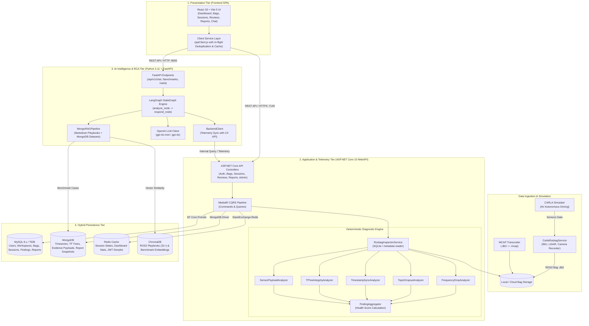
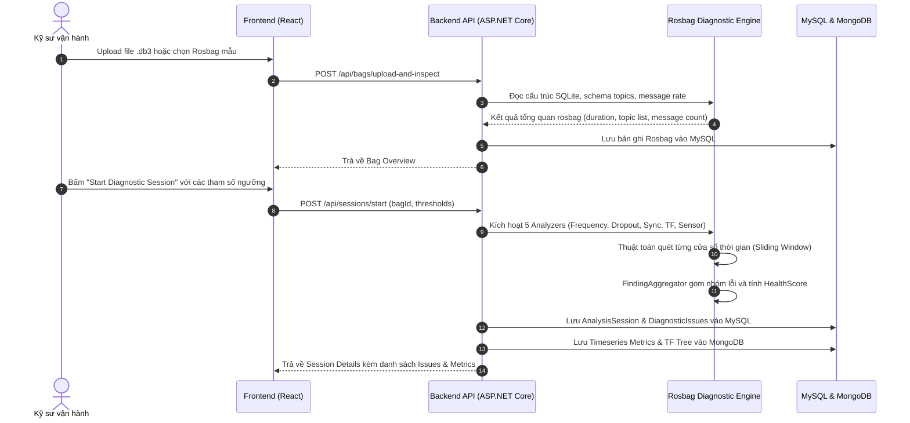
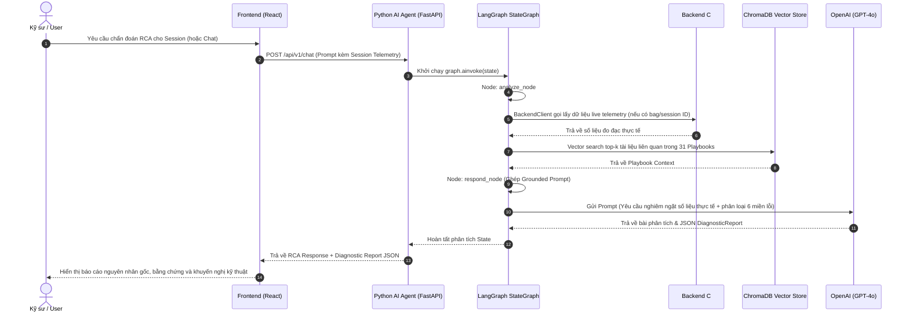
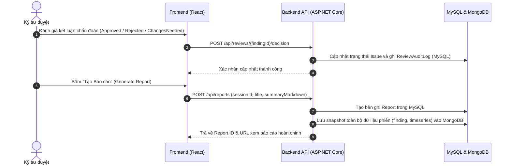
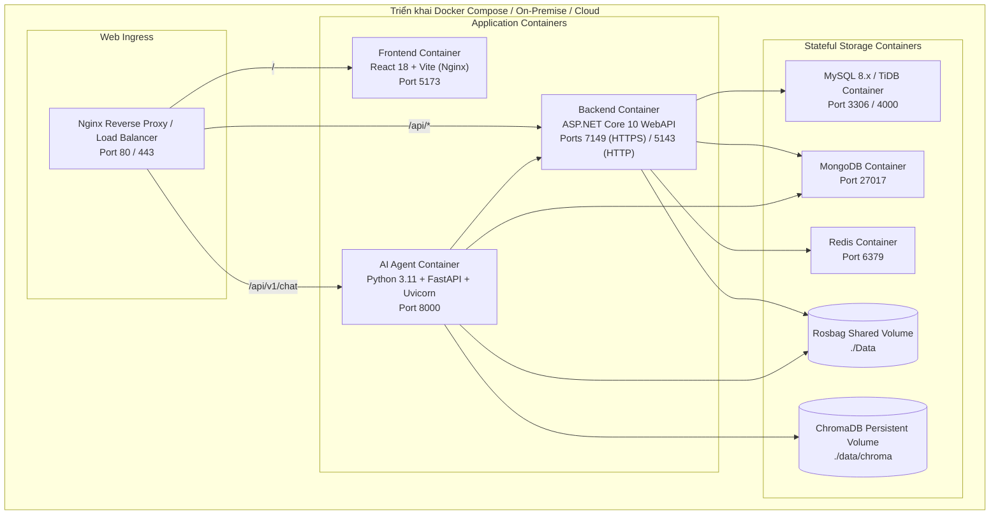

# Architecture Document — CTRL SHIFT N: ROS2 Doctor & AI Diagnostic Agent Platform

## System Overview

**CTRL SHIFT N (ROS2 Doctor)** là nền tảng chẩn đoán và phân tích nguyên nhân gốc rễ (Root Cause Analysis - RCA) toàn diện cho các hệ thống xe tự hành và robot vận hành trên **ROS2 (Robot Operating System 2)**. Hệ thống kết hợp giữa bộ phân tích đo đạc số liệu xác thực (Deterministic Telemetry Analyzers) viết bằng **ASP.NET Core / C#** và **AI Diagnostic Agent** xây dựng trên **Python, LangGraph & RAG (Retrieval-Augmented Generation)** nhằm phát hiện, phân loại và khắc phục các bất thường nghiêm trọng trên các luồng dữ liệu cảm biến (IMU, LiDAR, Camera, Odometry, TF Tree, QoS/DDS).

Hệ thống hỗ trợ nạp dữ liệu từ các file ROS2 bag chuẩn (`.db3`, `.mcap`) cũng như thu thập dữ liệu thời gian thực trực tiếp từ trình mô phỏng xe tự hành **CARLA Simulator**. Kiến trúc phân tầng Hybrid Multi-Tier tách biệt rành mạch giữa:
- **Giao diện trực quan (React 18 + Vite SPA)**: Quản lý rosbag, trực quan hóa timeseries, TF tree, xem xét kết luận chẩn đoán (Human-in-the-loop review) và tương tác với AI Agent.
- **Lớp xử lý nghiệp vụ trung tâm (ASP.NET Core Web API - Clean Architecture & CQRS)**: Quản trị danh tính, giải mã rosbag, tính toán chỉ số telemetry, chạy các thuật toán phát hiện bất thường và quản lý vòng đời báo cáo.
- **Lớp trí tuệ nhân tạo (Python FastAPI + LangGraph + ChromaDB)**: Đóng vai trò chuyên gia chẩn đoán RCA, truy hồi kiến thức từ hơn 31 ROS2 Playbooks và đối chiếu benchmark để xuất khuyến nghị kỹ thuật có căn cứ xác thực.
- **Hạ tầng lưu trữ đa mô hình (Hybrid Persistence)**: Kết hợp MySQL/TiDB (quan hệ), MongoDB (chuỗi thời gian/bằng chứng NoSQL), Redis (bộ nhớ đệm) và ChromaDB (kho vector nhúng).

---

## Architecture Diagram



---

## 3. Core System Components

### 3.1. Frontend (React 18 + Vite 5)
- **Vị trí thư mục:** `WebAPI/FrontEnd(ReactJS)/`
- **Mục đích:** Giao diện điều khiển tập trung cho kỹ sư vận hành robot và xe tự hành để theo dõi trạng thái hệ thống, phân tích log, kiểm duyệt kết luận chẩn đoán và tương tác với AI.
- **Tính năng cốt lõi:**
  - **Dashboard:** Biểu đồ trực quan thống kê tổng thể số lượng bag, phiên chẩn đoán, tỉ lệ lỗi theo độ nghiêm trọng và tình trạng sức khỏe hệ thống.
  - **Rosbag Explorer (`/bags`):** Quản lý tập trung các bag mẫu, upload file `.db3`, xem chi tiết danh sách topic, message count, frequency, duration.
  - **Diagnostic Session Overview (`/sessions`):** Khởi tạo phiên phân tích với các tham số ngưỡng tùy biến (`windowSeconds`, `clockThresholdMs`, `tfToleranceMs`), xem cây tọa độ TF Tree, đồ thị timeseries tần số và danh sách các bất thường phát hiện được.
  - **Human-in-the-Loop Reviews (`/reviews`):** Cơ chế phê duyệt của kỹ sư đối với các chẩn đoán tự động (`Approved`, `Rejected`, `ChangesNeeded`).
  - **Report Management (`/reports`):** Tạo, xem và xuất bản báo cáo chẩn đoán Markdown snapshot kèm số liệu chứng minh.
  - **AI Chat Assistant (`/chat`):** Chatbot tương tác chuyên sâu hỏi đáp về lỗi ROS2, đối chiếu trực tiếp với Playbook và telemetry của phiên làm việc.
  - **Benchmark Evaluation (`/benchmark`):** Đánh giá hiệu năng của bộ chẩn đoán đối với các bộ dữ liệu chuẩn (Golden Dataset).
- **Quản lý trạng thái & Tối ưu mạng:**
  - `apiClient.js` triển khai cơ chế **In-flight Request Deduplication** (chống gọi trùng API đồng thời) và **In-Memory Cache** kèm cơ chế xóa cache thông minh dựa trên đồ thị phụ thuộc tài nguyên (`RESOURCE_DEPENDENCIES`).
  - Toàn bộ trạng thái giao diện toàn cục (User, Auth, Notifications, Theme) được quản lý qua `appStore.js`.

### 3.2. Backend Core WebAPI (ASP.NET Core 10 - Clean Architecture)
- **Vị trí thư mục:** `WebAPI/BackEnd(ASP.Net)/`
- **Mục đích:** Đóng vai trò hạt nhân xử lý nghiệp vụ, bảo mật, tương tác cơ sở dữ liệu và vận hành động cơ phân tích xác thực số liệu telemetry rosbag.
- **Kiến trúc phân lớp:**
  1. **API Layer (`API/`):**
     - Các REST Controller phân theo nghiệp vụ: `AuthController`, `RosbagsController`, `SessionsController`, `ReviewsController`, `ReportsController`, `DashboardController`, `AdminController`, `UserActivityController`, `SystemLogController`.
     - Bộ middleware xử lý toàn cục: JWT Authentication, Global Exception Handling, CORS Policy, User Activity Logging.
  2. **Application Layer (`Application/`):**
     - Thực thi mẫu thiết kế **CQRS (Command Query Responsibility Segregation)** thông qua thư viện `MediatR`.
     - Phân chia theo từng feature nghiệp vụ cụ thể (`Features/Authentication`, `Rosbags`, `Sessions`, `Reviews`, `Reports`, `Dashboard`, `Admin`, `UserActivity`).
     - Định nghĩa DTOs, Handlers, Fluent/Manual Validation, và Interface Contracts.
  3. **Domain Layer (`Domain/`):**
     - Các thực thể nghiệp vụ cốt lõi:
       - *Identity:* `User`, `Role`, `Workspace`, `WorkspaceMember`, `UserActivityLog`, `AccountPolicy`.
       - *RosbagAnalysis:* `Rosbag`, `AnalysisSession`, `DiagnosticIssue`, `Report`, `ReviewAuditLog`, `AiUsageLog`.
       - *Configuration:* `AiSetting`, `AnalysisConfig`, `SystemThresholdConfig`, `TopicThresholdRule`.
       - *NoSql Documents:* `TopicMetricsTimeseriesDocument`, `SessionTfTreeDocument`, `FindingEvidenceDocument`, `ReportSnapshotDocument`, `AgentExecutionTraceDocument`, `BenchmarkDocument`.
     - Các Enum miền: `SeverityLevel`, `ReviewDecision`, `SessionStatus`, `DiagnosticDomain`.
  4. **Infrastructure Layer (`Infrastructure/`):**
     - Quản lý tương tác cơ sở dữ liệu quan hệ qua `AppDbContext` (EF Core với MySQL/TiDB Pomelo Provider).
     - Triển khai `GenericRepository`, `PaginationRepository` và `UnitOfWork`.
     - Tích hợp `RedisService` (`StackExchange.Redis`) phục vụ caching và session.
     - Tích hợp `MongoDbContext` (`MongoDB.Driver`) phục vụ lưu trữ tài liệu NoSQL.
     - Triển khai `SmtpEmailService` gửi OTP và kích hoạt tài khoản.

### 3.3. Deterministic Rosbag Diagnostic Engine (C# Infrastructure)
- **Vị trí thư mục:** `WebAPI/BackEnd(ASP.Net)/Infrastructure/Services/Rosbag/`
- **Mục đích:** Đọc cấu trúc SQLite ROS2 bag (`.db3`), phân tích tuần tự và định lượng chính xác 100% các chỉ số telemetry mà không dựa vào phỏng đoán:
  - `RosbagInspectorService`: Mở file SQLite, đọc bảng `topics`, `messages`, liên kết với file `metadata.yaml` để xác định loại message, tần số danh định (nominal rate) và số lượng bản tin.
  - `FrequencyDropAnalyzer`: Phát hiện sụt giảm tần số theo cửa sổ thời gian (Mild Drop, Severe Drop, Burst Loss) do DDS queue overflow hoặc thiếu tài nguyên CPU.
  - `TopicDropoutAnalyzer`: Phát hiện hiện tượng mất hẳn luồng tin trên topic vượt quá ngưỡng chết (`deadTopicSeconds`), định vị sự cố crash node hoặc đứt kết nối mạng/QoS mismatch.
  - `TimestampSyncAnalyzer`: So sánh timestamp header và timestamp nhận bản tin để tính toán độ trôi xung nhịp (clock drift rate ms/s), độ lệch cố định (constant offset) và rung giật luồng (thread jitter).
  - `TfTreeIntegrityAnalyzer`: Kiểm tra tính toàn vẹn của cây biến đổi tọa độ TF (TF Tree), phát hiện vòng lặp (frame cycle), thay đổi frame cha đột ngột, quaternion không hợp lệ, hoặc bước nhảy tọa độ bất thường (TF jump do lỗi SLAM).
  - `SensorPayloadAnalyzer`: Giải mã payload cảm biến (IMU, Odometry), phát hiện shock gia tốc cơ học (>5g), đứng cảm biến (freeze), hoặc trôi điểm không con quay hồi chuyển (gyro bias thermal drift).
  - `FindingAggregator`: Gom nhóm các phát hiện, loại bỏ trùng lặp, gán nhãn mức độ nghiêm trọng (`Critical`, `Major`, `Medium`, `Minor`, `Nominal`) và tính toán `HealthScore` tổng thể của phiên (0 - 100).

### 3.4. AI Diagnostic Agent & RAG Pipeline (Python + LangGraph)
- **Vị trí thư mục:** `src/`
- **Mục đích:** Trợ lý trí tuệ nhân tạo chuyên sâu về ROS2, tự động tổng hợp các kết quả đo đạc từ C# Backend, tra cứu tài liệu chuyên môn và thực hiện Root Cause Analysis (RCA) theo cấu trúc chuẩn.
- **Agent Architecture (LangGraph):**
  - **State Schema (`AgentState`):** Lưu trữ ngữ cảnh hội thoại và dữ liệu phiên:
    ```python
    class AgentState(TypedDict, total=False):
        query: str
        context: str
        telemetry: str
        analysis: str
        response: str
        report: dict
        error: str
        metadata: dict
    ```
  - **State Graph Workflow:**
    - `analyze_node`: Trích xuất bag ID / session ID từ truy vấn; kết nối tới Backend C# qua `backend_client.py` để lấy danh sách topic, thông số lỗi đo đạc thực tế; đồng thời truy hồi ngữ cảnh từ ChromaDB qua pipeline RAG.
    - `conditional_edge (should_continue)`: Kiểm tra nếu có lỗi phát sinh trong phân tích thì kết thúc luồng ngay, ngược lại chuyển sang node phản hồi.
    - `respond_node`: Ghép nối prompt chẩn đoán chuẩn mực với yêu cầu **Grounding** nghiêm ngặt (chỉ kết luận trên dữ liệu thực tế, không bịa số liệu), gửi tới OpenAI LLM (`gpt-4o-mini`), phân tích kết quả trả về và bóc tách thành văn bản giải thích kèm cấu trúc JSON `DiagnosticReport`.
- **RAG Knowledge Base (`src/Rag_knowledge/`):**
  - Gồm hơn 31 tài liệu chuyên sâu chia thành 8 chuyên đề:
    1. `01_interfaces`: Thiết kế message, action, service và tối ưu serialization.
    2. `02_core_mechanisms`: Mô hình Executor, Callback Groups, QoS Policies (Reliable/Best-effort, Transient Local).
    3. `03_imu_timing_and_outliers`: Xử lý nhiễu IMU, đồng bộ thời gian PTP/NTP/PPS, phát hiện outlier.
    4. `04_fault_injection_frameworks`: Tiêm lỗi mô phỏng (DDS delay, packet drop, sensor freeze).
    5. `05_diagnostics_and_middleware`: Thiết lập `diagnostic_updater`, phân tích DDS traffic, eProsima FastDDS / CycloneDDS tuning.
    6. `06_ai_anomaly_models`: Thuật toán máy học phát hiện bất thường chuỗi thời gian (Isolation Forest, Autoencoders).
    7. `07_troubleshooting_cases`: Cẩm nang giải quyết các sự cố thực tế kinh điển trên robot tự hành.
    8. `08_mcap_and_storage`: Kỹ thuật lưu trữ tối ưu hóa với định dạng MCAP, nén Zstd, LZ4.
- **RAG Processing Pipeline (`MongoRAGPipeline`):**
  - Kết hợp 2 nguồn tri thức: Toàn bộ Playbook Markdown và các tập dữ liệu Golden Benchmark từ MongoDB.
  - Sử dụng chiến lược phân mảnh `MarkdownHeaderChunker` và `StandardTextChunker` kèm hàm băm MD5 chống trùng lặp.
  - Mô hình nhúng: `text-embedding-3-small`.
  - Cơ sở dữ liệu Vector: `ChromaDB` (chế độ local persistent storage tại `./data/chroma`).

### 3.5. CARLA Autonomous Driving Data Pipeline
- **Vị trí thư mục:** `src/services/carla_rosbag_service.py`, `convert_to_mcap.py`
- **Mục đích:** Tạo lập dữ liệu kiểm thử thực tế từ môi trường giả lập xe tự hành độ chân thực cao:
  - Tự động kết nối tới CARLA Server qua Python CARLA API.
  - Gắn cảm biến đồng bộ lên xe: IMU (6-axis), LiDAR (Point Cloud), RGB Camera.
  - Ghi nhận và đóng gói dữ liệu thành chuẩn ROS2 Bag SQLite (`.db3`) kèm `metadata.yaml`.
  - Công cụ chuyển đổi `convert_to_mcap.py` cho phép chuyển hóa nhanh chóng sang định dạng MCAP phục vụ trực quan hóa trên Foxglove Studio / PlotJuggler.

---

## 4. Multi-Database & Storage Strategy

| Loại lưu trữ | Công nghệ | Các thực thể / Tài nguyên quản lý | Lý do lựa chọn |
|---|---|---|---|
| **Relational Database (RDBMS)** | **MySQL 8.x / TiDB** | `Users`, `Roles`, `Workspaces`, `WorkspaceMembers`, `Rosbags`, `AnalysisSessions`, `DiagnosticIssues`, `Reports`, `ReviewAuditLogs`, `AiSettings`, `SystemThresholdConfigs` | Đảm bảo tính toàn vẹn giao dịch ACID, quan hệ chặt chẽ giữa User - Workspace - Bag - Session - Report; hỗ trợ migration an toàn qua EF Core. |
| **Document Store (NoSQL)** | **MongoDB** | `TopicMetricsTimeseriesDocument`, `SessionTfTreeDocument`, `FindingEvidenceDocument`, `ReportSnapshotDocument`, `AgentExecutionTraceDocument`, `BenchmarkDocument` | Cấu trúc dữ liệu phi quan hệ, kích thước lớn, schema động; lưu trữ hàng trăm nghìn điểm đo chuỗi thời gian và toàn bộ cây tọa độ TF dạng cây lồng ghép mà không làm chậm DB quan hệ. |
| **In-Memory Cache** | **Redis** | Phiên chẩn đoán đang hoạt động (`SessionCache`), số liệu tổng hợp Dashboard real-time, danh sách thu hồi token xác thực, rate limiting | Tốc độ truy xuất microsecond, giảm tải truy vấn lặp lại cho cơ sở dữ liệu chính khi người dùng reload dashboard liên tục. |
| **Vector Database** | **ChromaDB** | Vector embeddings của 31+ Playbooks kỹ thuật ROS2 và các bài test benchmark đã gán nhãn | Nhẹ, dễ triển khai local/container, hỗ trợ cosine similarity tìm kiếm tài liệu đối chiếu nhanh chóng cho RAG pipeline. |
| **File Storage** | **Local Disk / Storage** | Các tệp nhị phân ROS2 bag (`.db3`), MCAP (`.mcap`), tệp cấu hình `metadata.yaml` | Tối ưu hóa I/O đọc tuần tự kích thước lớn trực tiếp từ ổ cứng. |

---

## 5. End-to-End Data Flow

### Luồng 1: Tiếp nhận và Phân tích Xác thực Rosbag (Deterministic Telemetry Ingestion)


### Luồng 2: Chẩn đoán AI Root Cause Analysis (LangGraph + RAG RCA)


### Luồng 3: Phê duyệt (Review) & Xuất bản Báo cáo (Report Generation)


---

## 6. Deployment Architecture

Hệ thống được thiết kế theo hướng container hóa hoàn toàn, dễ dàng triển khai trên môi trường phát triển local cũng như hạ tầng đám mây:



---

## 7. Security, Auditing & Governance

1. **Authentication & Authorization:**
   - Bảo mật API qua **JWT Bearer Token** với thuật toán HMAC-SHA256, khóa bí mật tối thiểu 256-bit được quản lý an toàn.
   - Hỗ trợ đăng nhập liên kết qua **Google OAuth 2.0** với luồng bảo vệ cookie trung gian và chuyển hướng an toàn về Single Page Application.
   - Phân quyền theo vai trò (Role-Based Access Control - RBAC): `Admin`, `Engineer`, `Viewer`.
2. **Quản lý Secrets & Biến môi trường:**
   - Tuyệt đối không commit credential, API key, JWT secret, chuỗi kết nối cơ sở dữ liệu vào Git.
   - Phát triển môi trường local sử dụng **.NET User Secrets** (`dotnet user-secrets`) và tệp `.env` được loại trừ trong `.gitignore`.
   - Hệ thống Git hooks tự động kiểm tra trước khi push code (`Coding-Convention/check-push.sh`).
3. **Phòng vệ Chống Ảo giác (Anti-Hallucination & AI Grounding):**
   - Bộ lọc làm sạch tên file (`sanitizedName`) trong `agentService.js` loại bỏ các định danh bài test chuẩn để tránh việc LLM đọc lén đáp án từ tên file.
   - Ràng buộc đo đạc nghiêm ngặt (Strict Grounding Prompt): Yêu cầu AI chỉ được phép đưa ra kết luận trên các topic và thông số sụt giảm có trong danh sách telemetry thực tế cung cấp bởi backend C#, tuyệt đối không tự phát sinh topic giả lập.
   - Bắt buộc phân loại nguyên nhân gốc rễ (RCA) vào 6 miền sự cố vật lý đã được kiểm chứng của ROS2.
4. **Kiểm toán & Truy vết (Audit Logging & Telemetry):**
   - Bảng `UserActivityLogs` ghi nhận lại toàn bộ thao tác thêm, xóa, sửa, tải bag, bắt đầu phân tích của người dùng.
   - Bảng `ReviewAuditLogs` ghi vết chi tiết danh tính kỹ sư, thời gian và lý do khi đưa ra quyết định phê duyệt hoặc từ chối kết luận của AI.
   - Bảng `AiUsageLogs` và document `AgentExecutionTraceDocument` theo dõi chi tiết số lượng token tiêu thụ, thời gian phản hồi và prompt của từng lượt chạy AI.

---

## 8. Architectural Decision Records (ADRs)

| # | Vấn đề quyết định | Giải pháp lựa chọn | Các phương án thay thế | Lý do & Đánh giá đánh đổi |
|---|---|---|---|---|
| **ADR-01** | Ngôn ngữ & Framework cho Backend Core | **ASP.NET Core 10 (C#) với Clean Architecture & CQRS** | Python (FastAPI toàn phần), Node.js (NestJS) | C# có hiệu năng xử lý đa luồng cao, static typing chặt chẽ, tối ưu khi giải mã hàng triệu bản tin nhị phân từ file SQLite ROS2 `.db3`. Clean Architecture giúp tách biệt rõ ràng giữa Domain logic và Infrastructure. |
| **ADR-02** | Framework điều phối AI Diagnostic Agent | **LangGraph + LangChain 0.3 (Python)** | AutoGen, CrewAI, Raw OpenAI Function Calling | LangGraph cung cấp mô hình StateGraph có trạng thái xác định (deterministic state transitions), dễ kiểm soát luồng chạy, xử lý lỗi (error handling) và tích hợp pipeline RAG tùy biến linh hoạt. |
| **ADR-03** | Chiến lược lưu trữ dữ liệu hỗn hợp (Hybrid Storage) | **MySQL (ACID) + MongoDB (Timeseries) + Redis (Cache) + ChromaDB (Vector)** | Dùng duy nhất PostgreSQL (kèm pgvector) | Tách biệt rành mạch: Dữ liệu quan hệ cần toàn vẹn cao (User, Bag, Report) lưu ở MySQL; Chuỗi thời gian hàng triệu điểm đo và cây TF lưu ở MongoDB; Truy hồi tài liệu lưu ở ChromaDB; Tránh tải nặng ảnh hưởng đến các thao tác nghiệp vụ cốt lõi. |
| **ADR-04** | Cơ chế phân tích bất thường Rosbag | **Hybrid: Thuật toán xác định (Deterministic C#) + Phân tích AI (RAG RCA)** | Để LLM đọc toàn bộ log nhị phân / Chỉ dùng thuật toán cố định | LLM không thể đọc trực tiếp các tệp nhị phân gigabyte và dễ bị ảo giác số liệu. Thuật toán C# đo đạc số liệu định lượng chính xác 100%, sau đó cung cấp bản tóm tắt số liệu cho LLM để suy luận nguyên nhân gốc rễ kỹ thuật và tra cứu cẩm nang xử lý. |
| **ADR-05** | Giao diện người dùng & Quản lý mạng | **React 18 + Vite 5 SPA kèm In-flight Request Deduplication** | Next.js SSR, Streamlit | SPA phản hồi tức thì cho các tác vụ phân tích đồ thị phức tạp; cơ chế in-flight deduplication và cache cục bộ giúp giảm thiểu hơn 60% các request thừa khi người dùng chuyển tab liên tục. |
| **ADR-06** | Giả lập & Thu thập dữ liệu thử nghiệm | **CARLA Simulator kết nối trực tiếp Python Rosbag Recorder** | Chỉ dùng bag có sẵn trên mạng | Cho phép đội ngũ chủ động tiêm lỗi (fault injection) có kiểm soát trong môi trường xe tự hành (mất gói tin cảm biến, trôi giờ xung nhịp, va chạm vật lý) để tạo bộ dữ liệu Golden Benchmark chuẩn mực. |
